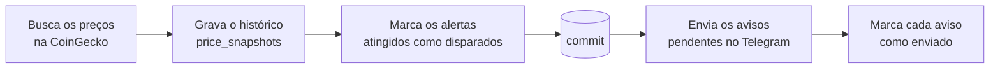
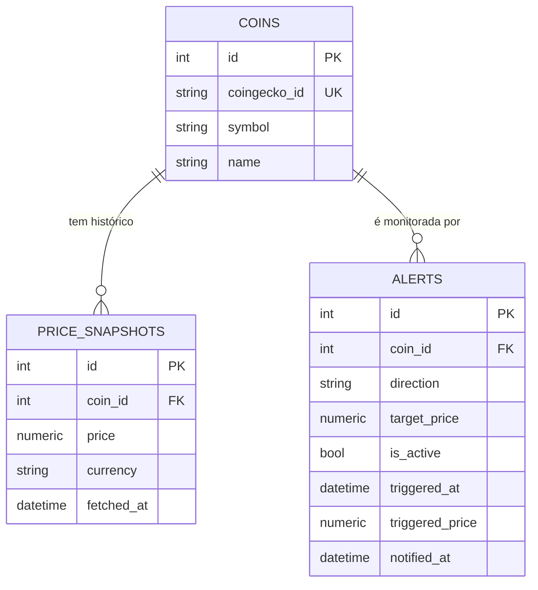
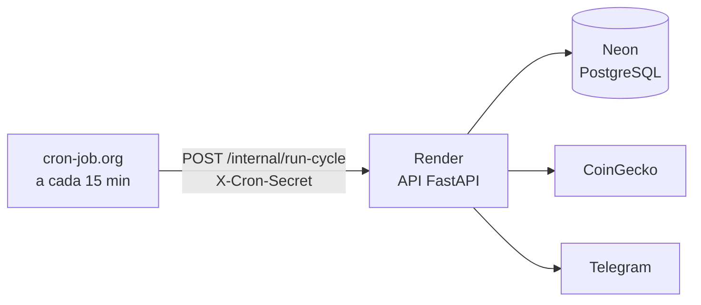

# Crypto Price Alerts

[](https://github.com/tassohenrique/crypto-price-alerts/actions/workflows/ci.yml)


Monitor de preços de criptomoedas com alertas no Telegram. Um worker consulta os preços na CoinGecko em intervalos regulares, guarda o histórico e, quando uma moeda cruza o preço-alvo de um alerta, envia uma mensagem no Telegram. Os alertas são gerenciados por uma API REST.

```text
Bitcoin (BTC) subiu para R$ 612.345,67.
Seu alerta: acima de R$ 600.000,00.
```

## Funcionalidades

- **Monitoramento contínuo:** um worker busca os preços em reais de todas as moedas cadastradas numa única chamada à CoinGecko, em intervalos regulares (5 minutos no ambiente local, 15 em produção)
- **Cadastro de moedas pela API:** basta o id da CoinGecko; o símbolo e o nome vêm da própria CoinGecko, que também confirma que a moeda existe
- **Histórico de preços:** cada busca grava um registro por moeda, indexado por moeda e data, e a API consulta o histórico por período
- **Alertas de alta e de baixa:** dispara quando o preço sobe até o alvo ou acima (`above`), ou cai até o alvo ou abaixo (`below`)
- **Avisos no Telegram** com os valores formatados em reais; moedas abaixo de R$ 1 mantêm até 8 casas decimais
- **Entrega garantida:** se o Telegram falhar, o aviso fica pendente e é reenviado no ciclo seguinte
- **Rearme:** um alerta que já disparou pode ser reativado pela API
- **API protegida por chave** (`X-API-Key`) para gerenciar moedas e alertas
- **Alarme de worker parado:** uma rota de saúde responde `503` se os preços pararem de chegar

## Tecnologias

- **Python 3.14** e **FastAPI**
- **PostgreSQL 17**, **SQLAlchemy 2.1** e **Alembic** (migrations)
- **httpx** (clientes da CoinGecko e do Telegram) e **Pydantic Settings** (configuração)
- **pytest** e **pytest-cov** (mais de 100 testes, com as APIs externas simuladas)
- **Ruff** (lint e formatação)
- **Docker** e **Docker Compose**

## Como funciona

O projeto tem dois processos que compartilham o mesmo banco: a **API**, que gerencia os alertas, e o **worker**, que busca os preços e envia os avisos. No ambiente local o worker roda em loop; em produção, um agendador externo dispara um ciclo de cada vez (veja [Deploy](#deploy-tudo-em-planos-gratuitos)). Cada ciclo:



Disparar o alerta e enviar o aviso são etapas separadas. Um alerta disparado (`triggered_at` preenchido) com `notified_at` vazio é um aviso pendente, e o worker tenta enviá-lo a cada ciclo até conseguir.

## Modelo de dados



## Rotas

As rotas de `/coins` e `/alerts` exigem o cabeçalho `X-API-Key` com o valor de `API_KEY` do `.env`.

| Método | Rota | Descrição |
|---|---|---|
| GET | `/health` | Verifica se a API e o banco estão no ar |
| GET | `/health/worker` | Verifica se o worker está gravando preços em dia: `503` se o preço mais recente tiver mais de 30 min |
| GET | `/coins` | Lista as moedas acompanhadas, em ordem alfabética |
| POST | `/coins` | Cadastra uma moeda pelo id da CoinGecko (`422` se o id não existir lá, `502` se a CoinGecko falhar) |
| GET | `/coins/{id}/prices` | Histórico de preços, do mais recente para o mais antigo. Filtros `start` (inclusivo) e `end` (exclusivo), em UTC, e `limit` (1 a 1000, padrão 100) |
| GET | `/alerts` | Lista os alertas, do mais recente para o mais antigo |
| GET | `/alerts?active=true` | Só os ativos (`false` para os já disparados) |
| GET | `/alerts/{id}` | Busca um alerta |
| POST | `/alerts` | Cria um alerta |
| POST | `/alerts/{id}/rearm` | Reativa um alerta que já disparou e já teve o aviso enviado |
| DELETE | `/alerts/{id}` | Apaga um alerta |
| POST | `/internal/run-cycle` | Roda um ciclo do worker. Só para o agendador: exige `X-Cron-Secret` e fica fora do `/docs` |

Exemplo de criação de alerta:

```bash
curl -X POST http://localhost:8001/alerts \
  -H "X-API-Key: $API_KEY" \
  -H "Content-Type: application/json" \
  -d '{"coin_id": 1, "direction": "above", "target_price": "600000"}'
```

Envie o `target_price` como texto para não perder precisão. A documentação interativa fica em [`/docs`](http://localhost:8001/docs).

## Decisões técnicas

Um resumo abaixo. O contexto completo de cada decisão, com as alternativas descartadas, fica nos [registros de decisão de arquitetura](docs/adr/README.md).

**Dinheiro sem `float`.** Preços são `Decimal` do começo ao fim: a resposta da CoinGecko é lida com `parse_float=Decimal` e pedida com `precision=full`, e o banco usa `NUMERIC(30, 12)`, suficiente para moedas que valem frações de centavo.

**Aviso pendente em vez de envio imediato.** O worker primeiro confirma no banco quais alertas dispararam e só depois envia as mensagens, cada uma com o seu commit. Se o Telegram estiver fora do ar ou o worker cair no meio do ciclo, nenhum aviso se perde: ele continua pendente e sai no próximo ciclo.

**O token do bot nunca vai para o log.** A URL da API do Telegram contém o token. Os erros do cliente nunca incluem a URL, e o log de requisições do httpx fica restrito a avisos e erros.

**Worker resiliente.** Uma falha na CoinGecko (incluindo o limite de requisições, HTTP 429) pula só a busca de preços daquele ciclo; os avisos pendentes continuam sendo enviados. Qualquer erro inesperado faz rollback e o worker segue para o próximo ciclo. Ao receber `SIGTERM` ou `SIGINT`, ele termina o ciclo atual e encerra sem cortar nada pela metade.

**Arquitetura em camadas.** Routers (HTTP), services (regras de negócio) e repositories (acesso ao banco). Os services não conhecem HTTP: lançam exceções da aplicação, que um único handler converte em 401, 404, 409, 422 ou 502. A mesma regra de disparo é usada pelo worker e coberta pelos testes, inclusive o caso do preço exatamente igual ao alvo, que dispara.

**Regras protegidas também no banco.** Preço-alvo e preços do histórico positivos são garantidos por constraints no PostgreSQL, além da validação na API. A chave de API é comparada em tempo constante (`secrets.compare_digest`).

## Como rodar localmente

Pré-requisitos: Docker, uma chave gratuita da [CoinGecko](https://www.coingecko.com/en/api) (plano Demo) e um bot do Telegram.

**1. Configure o ambiente**

```bash
git clone https://github.com/tassohenrique/crypto-price-alerts.git
cd crypto-price-alerts
cp .env.example .env
```

No `.env`, troque a senha do banco (nas três variáveis em que ela aparece) e preencha:

| Variável | Como obter |
|---|---|
| `COINGECKO_API_KEY` | Crie em [coingecko.com/en/api](https://www.coingecko.com/en/api) |
| `TELEGRAM_BOT_TOKEN` | Converse com o [@BotFather](https://t.me/BotFather) no Telegram e use `/newbot` |
| `TELEGRAM_CHAT_ID` | Mande uma mensagem para o seu bot e abra `https://api.telegram.org/bot<TOKEN>/getUpdates`; o id está em `message.chat.id` |
| `API_KEY` | Qualquer valor secreto, por exemplo `python -c "import secrets; print(secrets.token_urlsafe(32))"` |
| `POLL_INTERVAL_SECONDS` | Opcional. Intervalo entre os ciclos do worker; o padrão é 300 |
| `LOG_FORMAT` | Opcional. `text` (padrão, para ler no terminal) ou `json` (uma linha JSON por log, usado em produção) |
| `CRON_SECRET` | Opcional. Segredo do agendador externo para `POST /internal/run-cycle`; sem ele, a rota fica desligada |

**2. Suba os serviços e crie as tabelas**

```bash
docker compose up -d --build
docker compose exec app alembic upgrade head
```

A API sobe em http://localhost:8001 e o banco fica exposto na porta 5433.

**3. Cadastre as moedas que quer acompanhar**

Use o id da moeda na CoinGecko, o mesmo que aparece na URL da moeda no site. O símbolo e o nome são buscados na própria CoinGecko:

```bash
curl -X POST http://localhost:8001/coins \
  -H "X-API-Key: $API_KEY" \
  -H "Content-Type: application/json" \
  -d '{"coingecko_id": "bitcoin"}'
```

Ou pelo [`/docs`](http://localhost:8001/docs), depois de clicar em **Authorize** e informar a chave.

Depois disso, crie alertas pela API. Para acompanhar o worker:

```bash
docker compose logs -f worker
```

### Desenvolvimento sem Docker para a API

```bash
docker compose up -d db
python -m venv .venv
source .venv/bin/activate
pip install -r requirements-dev.txt
alembic upgrade head
fastapi dev app/main.py        # API
python -m app.worker           # worker, em outro terminal
```

Fora do Docker, as variáveis `DATABASE_URL` e `TEST_DATABASE_URL` do `.env` apontam para `localhost:5433`.

### Imagem de produção

O `Dockerfile` gera uma imagem enxuta (só as dependências de produção, sem testes, rodando sem root). A mesma imagem serve aos três processos; as migrations rodam primeiro:

```bash
docker build -t crypto-price-alerts .
docker run --rm --env-file .env crypto-price-alerts alembic upgrade head   # 1. migrations
docker run -d --env-file .env -p 8000:8000 crypto-price-alerts             # 2. API
docker run -d --env-file .env crypto-price-alerts python -m app.worker     # 3. worker
```

O `DATABASE_URL` precisa apontar para um banco que o container alcance (em produção, o banco gerenciado; o `localhost:5433` do `.env` de desenvolvimento não funciona de dentro do container). A API escuta na porta da variável `PORT` (8000 se não for definida). O CI constrói essa imagem a cada push e confere que as migrations rodam e que o `/health` responde.

## Deploy (tudo em planos gratuitos)



- **API:** serviço web gratuito no Render, construído a partir do `Dockerfile`. Ao subir, aplica as migrations (`alembic upgrade head`) e depois inicia o FastAPI. No plano gratuito, o serviço hiberna sem acessos e a primeira requisição depois disso demora alguns segundos.
- **Banco:** PostgreSQL gratuito no Neon. Ele suspende sozinho quando fica sem uso, por isso o ciclo é de 15 minutos: entre um ciclo e outro o banco dorme e o limite mensal de computação não estoura.
- **Worker:** o [cron-job.org](https://cron-job.org) (gratuito) chama `POST /internal/run-cycle` a cada 15 minutos, com o cabeçalho `X-Cron-Secret`. A rota roda um ciclo e responde com o resumo (`prices_saved`, `alerts_triggered`...). As chamadas também mantêm a API acordada no Render.
- **Um ciclo por vez:** o ciclo pega uma trava no PostgreSQL (`pg_try_advisory_lock`) antes de começar. Se outro ciclo estiver rodando, em qualquer processo, a rota responde `409` e não faz nada, então nenhum aviso sai em dobro.
- **Segredo separado:** `CRON_SECRET` só dispara ciclos; a `API_KEY`, que gerencia os alertas, nunca sai do Render. Sem `CRON_SECRET`, a rota fica desligada (`404`).

- **Alarme se o worker parar:** `GET /health/worker` responde `503` quando o preço mais recente passa de 30 minutos (`WORKER_STALE_AFTER_MINUTES`). Um preço novo só aparece se tudo funcionou de ponta a ponta (agendador, CoinGecko e banco), então esse é o sinal. Um monitor gratuito, como o [UptimeRobot](https://uptimerobot.com), apontado para essa rota avisa por e-mail se algo parar.

Por que não o agendamento do GitHub Actions: num teste de ~20 horas, ele rodou só 4 das ~80 execuções previstas, com intervalos de 3 a 6 horas. O workflow `worker.yml` continua disponível para rodar um ciclo manualmente.

### Dependências com versões fixas

O `requirements.txt` lista a versão exata de cada pacote, inclusive das dependências das dependências, para que todo build instale o mesmo que passou no CI. Ele é gerado, não editado à mão: as dependências diretas ficam no `requirements.in` (e as de desenvolvimento no `requirements-dev.in`). Para adicionar ou atualizar um pacote, edite o `.in` e rode:

```bash
docker compose run --rm app python -m scripts.lock_requirements
docker compose up -d --build
```

## Testes

Os testes usam um banco separado. Crie ele uma única vez:

```bash
docker compose exec db createdb -U crypto crypto_test
```

Depois:

```bash
docker compose exec app python -m pytest -v
docker compose exec app python -m pytest --cov=app --cov-report=term-missing   # com cobertura
```

As chamadas à CoinGecko e ao Telegram são simuladas com `httpx.MockTransport`, então os testes não precisam de internet nem de chaves reais.

## Autor

**Tasso Rodrigues** · [LinkedIn](https://www.linkedin.com/in/tassorodrigues/) · [GitHub](https://github.com/tassohenrique)
